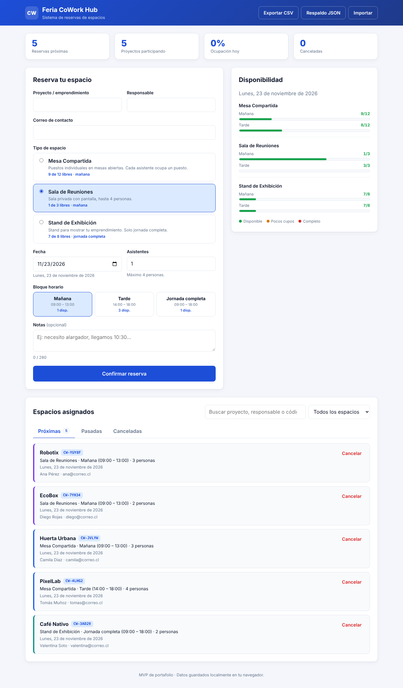

# Feria CoWork Hub · Sistema de reservas

Sistema web para reservar espacios de trabajo durante una feria de emprendimiento en un CoWork: **mesas compartidas, salas de reuniones y stands de exhibición**. Controla la capacidad real de cada espacio por bloque horario, evita sobre‑reservas y deja todo listo para exportar.

Hecho en **HTML, CSS y JavaScript sin dependencias**: no necesita build, framework ni backend, por lo que se publica directo en **GitHub Pages**.

🔗 **Demo:** https://agaquest.github.io/mvp-cowork/



## Funcionalidades

- **Capacidad real por bloque**: 12 puestos de mesa, 3 salas y 8 stands, en bloques de mañana, tarde o jornada completa. Una jornada completa ocupa ambos bloques.
- **Disponibilidad en vivo**: un panel muestra la ocupación del día elegido y el formulario deshabilita los bloques llenos.
- **Reglas de negocio validadas**: sin fechas pasadas, ni domingos, ni reservas a más de 60 días; tope de asistentes por espacio; stands solo por jornada completa; máximo 2 reservas por proyecto al día; sin reservas duplicadas que se superpongan.
- **Código de reserva** único (ej. `CW-7F3KQ`) que se muestra al confirmar.
- **Cancelación con confirmación** que libera el cupo y se guarda en el historial (no se borra).
- **Listado con pestañas** (próximas, pasadas y canceladas), **búsqueda** por proyecto, responsable, correo o código, y **filtro** por espacio.
- **Indicadores**: reservas próximas, proyectos participantes, ocupación del día y canceladas.
- **Exportar a CSV** compatible con Excel en español (separador `;`, con BOM) y **respaldo/importación en JSON**, con opción de combinar o reemplazar.
- **Accesible**: etiquetas asociadas, errores con `aria-invalid`/`aria-describedby`, pestañas navegables con flechas, diálogos nativos `<dialog>`, avisos con `aria-live` y soporte para `prefers-reduced-motion`.
- **Responsive y con modo oscuro** automático.

## Robustez

| Problema en la v1 | Solución en la v2 |
|---|---|
| `innerHTML` con texto del usuario (XSS) | El DOM se construye con `createElement`/`textContent` |
| `onclick` global con índices que se desfasan | Delegación de eventos e identificadores únicos (`crypto.randomUUID`) |
| `JSON.parse` sin control: los datos corruptos rompían la app | Esquema versionado, saneamiento registro por registro y respaldo de los datos dañados |
| Sin control de capacidad ni de fechas | Validación completa en una capa de dominio pura |
| Fechas con `toISOString` (en Chile, de noche, devuelve el día siguiente) | Las fechas se manejan siempre en hora local |
| Sin migración | Las reservas del formato anterior se migran automáticamente |
| Sin tests | 32 tests con `node:test` y CI en GitHub Actions |

También traduce los errores de cuota de `localStorage` a mensajes claros, sincroniza entre pestañas y protege el CSV contra inyección de fórmulas.

## Arquitectura

```
index.html          Estructura y semántica
css/styles.css      Estilos con design tokens (claro/oscuro)
js/config.js        Catálogo de espacios, bloques y reglas (lo configurable)
js/bookings.js      Dominio puro: validación, capacidad, filtros y estadísticas
js/storage.js       Repositorio versionado sobre localStorage + migración
js/export.js        CSV / JSON
js/app.js           Controlador de la interfaz
tests/              Tests unitarios (node:test, sin dependencias)
```

La lógica de negocio no toca el DOM ni `localStorage`: recibe datos y devuelve datos (la fecha "actual" también se inyecta). Por eso se puede testear en Node y, más adelante, reemplazar el almacenamiento por una API sin reescribir las reglas.

Para cambiar capacidades, horarios o días de cierre basta con editar `js/config.js`.

## Cómo ejecutarlo

Usa módulos ES, así que hay que servirlo por HTTP (abrirlo con `file://` no funciona):

```bash
npm start              # equivale a: python3 -m http.server 5173
# abre http://localhost:5173
```

Sirve cualquier servidor estático (`npx serve` o la extensión Live Server de VS Code).

## Publicar en GitHub Pages

El sitio es 100 % estático y usa rutas relativas, así que funciona tal cual en `https://<usuario>.github.io/mvp-cowork/`.

1. Sube el contenido de esta carpeta a la rama `main` del repositorio.
2. En GitHub: **Settings → Pages → Build and deployment → Source: Deploy from a branch**.
3. Elige la rama `main` y la carpeta `/ (root)`, y pulsa **Save**.
4. En uno o dos minutos el sitio queda disponible en la URL que muestra esa misma página.

El archivo `.nojekyll` evita que GitHub procese el sitio con Jekyll, y el workflow `CI` corre los tests en cada push.

## Tests

```bash
npm test               # requiere Node 20 o superior
```

Cubren las fechas (zona horaria, fechas imposibles, días cerrados), la capacidad por bloque y por asistente, las superposiciones, las reglas por proyecto, la cancelación, los filtros, la migración desde la v1, los datos corruptos, la importación y el escapado del CSV.

## Próximos pasos posibles

- Backend (por ejemplo, Supabase o Express + SQLite) para compartir las reservas entre dispositivos.
- Autenticación de organizadores y una vista de administración.
- Envío del código de reserva por correo.
- Edición de reservas y lista de espera cuando un bloque está lleno.
